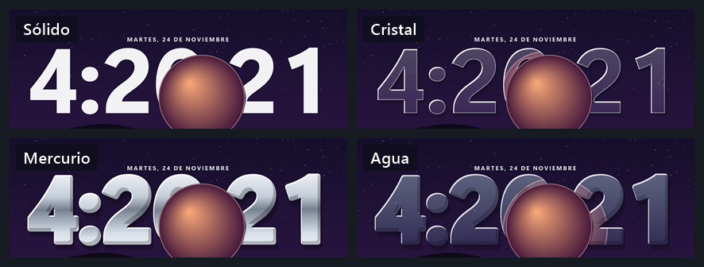

  

<h1 align="center">Streeck Suite</h1>

  Personaliza Windows 11: isla dinámica arriba, barra de tareas con skins, ojitos con personalidad, reloj 3D sobre tu fondo y más.

  <a href="https://apps.microsoft.com/detail/9NS9KQMV2ZN3"><b>Consíguela en Microsoft Store</b></a>

---

- **¿Ya la tenías instalada desde aquí?** Se sigue actualizando sola, como siempre.
- **Política de privacidad:** [streeck1985.github.io/streeck-suite/privacidad.html](https://streeck1985.github.io/streeck-suite/privacidad.html)
