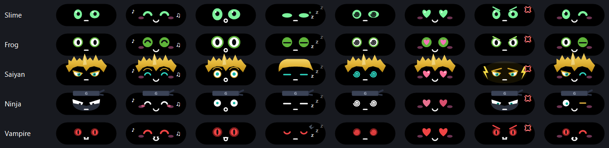
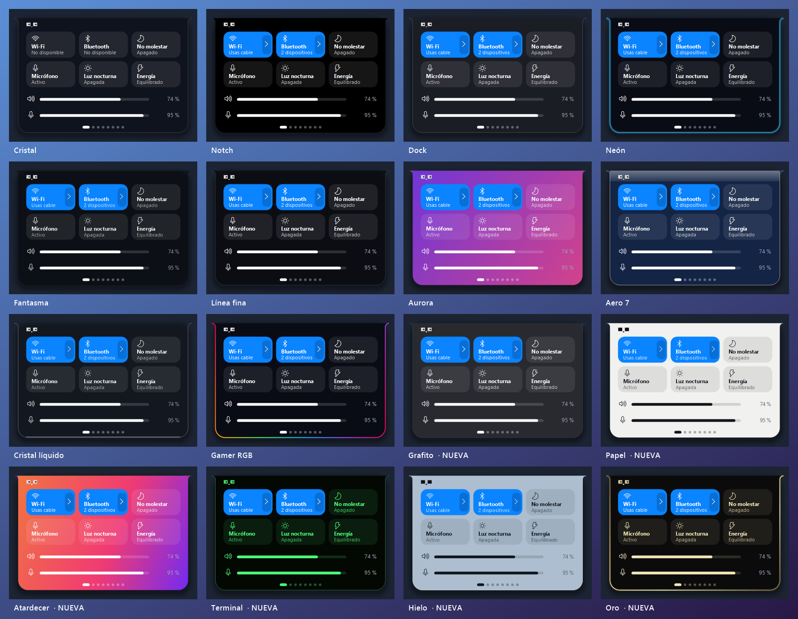
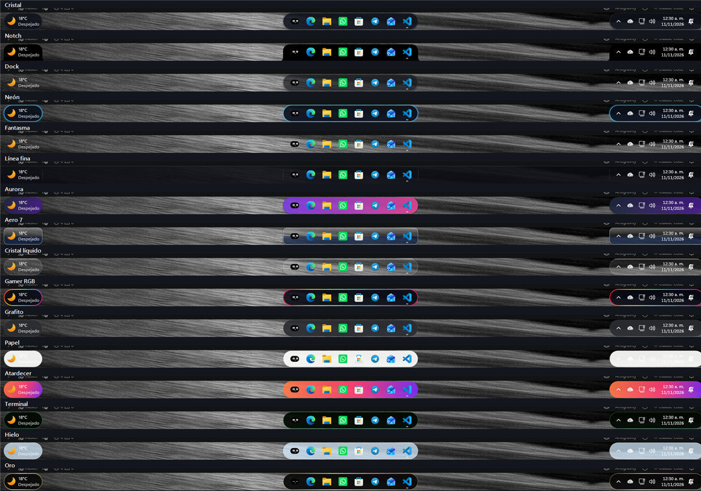
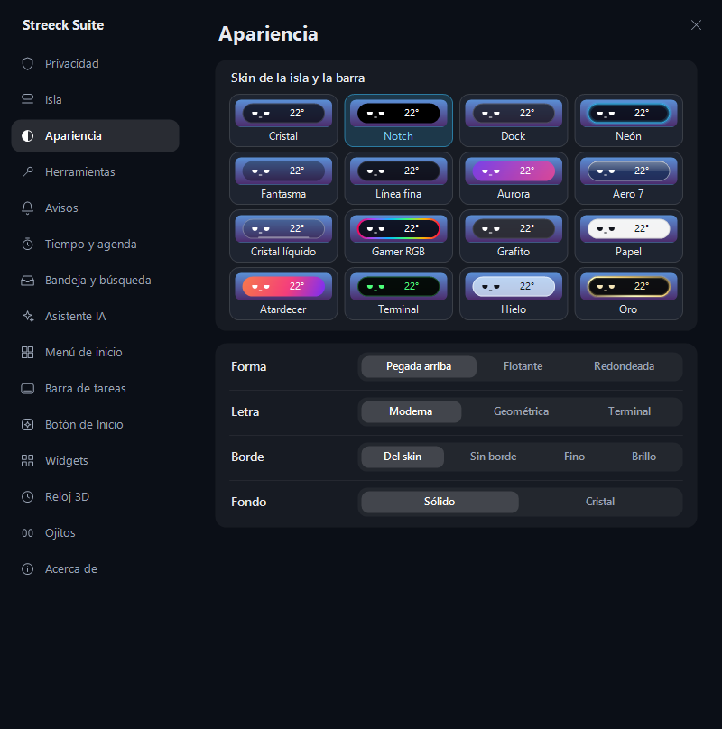
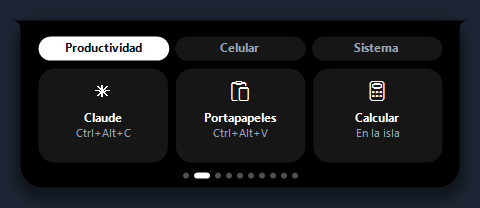
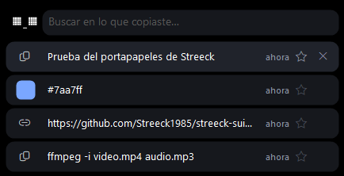
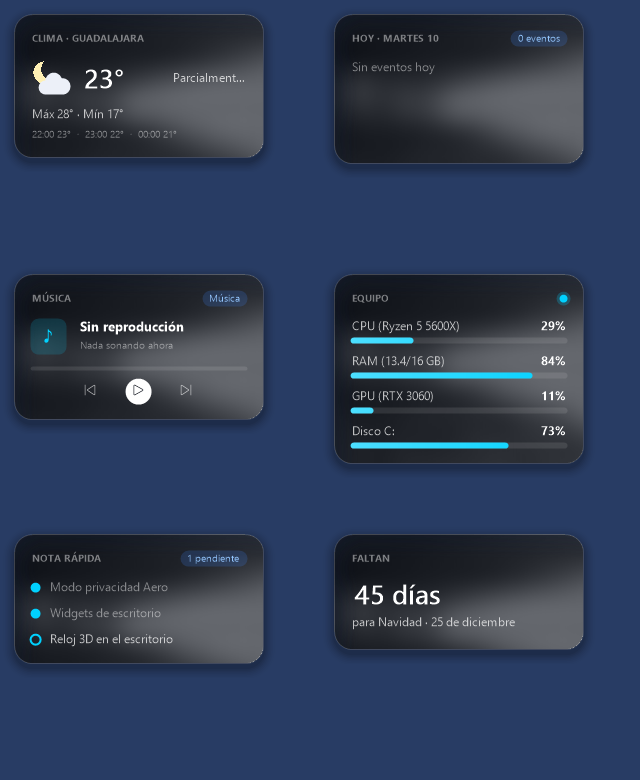
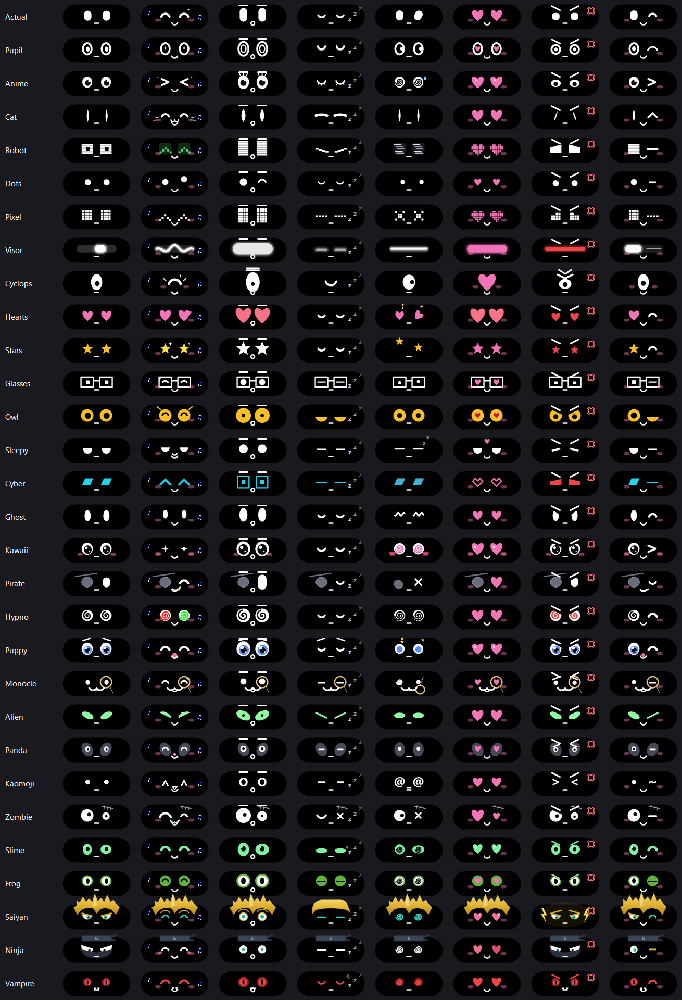

  

<h1 align="center">Streeck Suite</h1>

  Personaliza Windows 11: isla dinámica arriba, barra de tareas con skins, ojitos con personalidad, reloj 3D sobre tu fondo y más. 
  Ligera (≈ 45 MB de RAM y casi 0 % de CPU en reposo), en español y sin depender de otros programas.

  <a href="https://github.com/Streeck1985/streeck-suite/releases/latest/download/StreeckSuite-Setup.exe"><b>⬇️ Descargar Streeck Suite</b></a>
  &nbsp;·&nbsp;
  <a href="https://github.com/Streeck1985/streeck-suite/releases">Todas las versiones</a>

---

> ℹ️ **¿Ya la tenías instalada (versión 1.3.2 o anterior)?** Descarga e instala la versión nueva a mano una vez: el buscador de actualizaciones de esas versiones no veía las nuevas. Desde la 1.3.3 se actualiza sola.

## ✨ Novedades de la 1.4.2

### 5 ojitos más: ya son 30
**Slime, Rana, Saiyajin, Ninja y Vampiro**, cada uno con sus 8 caras. Y los 25 de antes estrenan **feliz y mareado con personalidad**: el fantasma flota y se derrite, el búho voltea la cabeza, el monóculo se resbala, el pirata enseña su diente de oro… El gato ahora es **pura pupila**.

### Y más
- **Hora en 12 o 24 horas:** en automático usa el mismo formato que Windows (reloj 3D, isla, agenda y widgets). También puedes elegirlo en **Ajustes › Tiempo**.
- **Mi ciudad para el clima:** si el clima automático te ubica mal, elige tu ciudad.
- **Se actualiza sola:** las versiones nuevas se instalan cuando no estás usando la PC (y nunca a media partida).
- **PCs con Snapdragon (ARM):** las islas de la barra de tareas ahora también funcionan ahí.
- **Herramientas en Ajustes:** captura, calculadora y bloquear también desde **Ajustes › Herramientas**.
## ✨ Novedades de la 1.4.0

### 16 skins para la isla y la barra
Seis nuevas (**Grafito, Papel, Atardecer, Terminal, Hielo y Oro**) además de las 10 de siempre. En **Ajustes › Apariencia** también eliges la forma (pegada arriba, flotante o la nueva **redondeada**), la letra, el borde (fino o brillo animado) y el fondo sólido o cristal. Con Papel y Hielo la suite pone Windows en modo claro y, al volver a una skin oscura, deja tu configuración como estaba.

### Herramientas en la isla
Una tarjeta nueva en el carrusel con todo a la mano, por categorías: **Claude** (pregúntale con tu cuenta de claude.ai, sin pagar API), **portapapeles** con historial y buscador, **calculadora**, **enviar y recibir con el celular** por QR y tu Wi-Fi (sin internet ni apps), **silenciar el micrófono**, **captura de pantalla** y **bloquear la PC**. Cada botón trae su atajo escrito.

  
  

### Y más
- **Controles rápidos nuevos:** micrófono (Ctrl + Alt + M, con aviso rojo en la isla), luz nocturna y modo de energía.
- **Widgets nuevos:** clima, agenda de hoy, música con botones, equipo y cuenta regresiva.
- **25 estilos de ojitos** (10 nuevos) y lo que quieras junto a ellos: clima, hora, fecha, CPU, tu próximo evento o el **cronómetro**.
- **Avisos de agentes de IA:** la isla te dice cuando Claude Code termina o te pide permiso.
- **Reloj 3D:** en «Contorno» los números se paran sobre la silueta, y los fondos de dos monitores se ven completos.
- Al actualizar, una ventana te muestra las **novedades** con botones para probarlas.

  
  

## Isla dinámica

Una isla negra arriba de la pantalla que se abre al pasar el ratón: música con letra, centro de control (Wi-Fi, Bluetooth, volumen y micrófono), calendario con pomodoro, clima, sistema y avisos.

  
  

  

También reemplaza el aviso de volumen de Windows por el suyo:

## Ojitos con personalidad

Cuando la isla está cerrada puede mostrar unos ojitos que te siguen con la mirada, parpadean y reaccionan a lo que pasa: se ponen felices con la música, se sorprenden con un aviso, se marean si sacudes el ratón, te guiñan cuando terminas una tarea… y cuando no usas la PC bostezan, cabecean, silban o se estiran hasta quedarse dormidos.

30 estilos (Actual, Con pupila, Anime, Gato, Robot, Puntitos, Pixel, Visor LED, Cíclope, Corazones, Estrellas, Lentes, Búho, Somnoliento, Ciber, Fantasma, Kawaii, Pirata, Espiral, Cachorro, Monóculo, Alien, Panda, Kaomoji, Zombi, Slime, Rana, Saiyajin, Ninja y Vampiro), 5 colores, cejas, boquita y rubor.

Con música sonando, la carita se pone feliz junto al ecualizador:

## Barra de tareas con skins

Le pone skin a **la barra real de Windows** (no es una barra falsa): islas a los extremos, 16 skins y un mini reproductor. Funciona en varios monitores.

### Icono del botón de Inicio

Cambia el logo de Windows por el logo Streeck, un orbe, unos ojitos que parpadean, una luna, un destello o tu propia imagen. Al darle clic abre el menú de Streeck.

## Panel de ajustes

Todo se configura desde un panel propio en español.

  
  

  
  

## Y además

- **Reloj 3D** sobre tu fondo de pantalla: detrás del sujeto o con contorno, con la fuente que quieras.
- **Menú de inicio y búsqueda** propios, con asistente de IA (local o Gemini).
- **Icono del botón de Inicio** a tu gusto: logo Streeck, orbe, ojitos que parpadean, luna, destello o tu propia imagen.
- **Modo privacidad** con desenfoque (Ctrl + Alt + P).
- **Bandeja de archivos**, widgets, tareas y recordatorios.
- **Se actualiza sola**: revisa este repositorio y la isla te avisa cuando hay versión nueva.

## Instalar

1. Descarga **[StreeckSuite-Setup.exe](https://github.com/Streeck1985/streeck-suite/releases/latest/download/StreeckSuite-Setup.exe)**.
2. Ábrelo y pulsa **Instalar**. No pide permisos de administrador.
3. Si Windows muestra *«Windows protegió su PC»*, pulsa **Más información → Ejecutar de todas formas** (pasa con los programas nuevos que aún no tienen firma digital).

**Requisitos:** Windows 11 de 64 bits.

Para desinstalar: **Configuración → Aplicaciones → Streeck Suite → Desinstalar**. La barra de Windows vuelve a quedar como estaba.
