

  

<h1 align="center">Streeck Suite</h1>

  Personaliza Windows 11: isla dinámica arriba, barra de tareas con skins, ojitos con personalidad, reloj 3D sobre tu fondo y más. 
  Ligera (≈ 45 MB de RAM y casi 0 % de CPU en reposo), en español y sin depender de otros programas.

  <a href="https://apps.microsoft.com/detail/9NS9KQMV2ZN3"><b>🛍️ Consíguela en Microsoft Store</b></a>

---

> ℹ️ **¿Ya la tenías instalada desde aquí?** No tienes que hacer nada: se sigue actualizando sola, como siempre.

## ✨ Novedades de la 1.4.13

**Streeck Suite ya está en [Microsoft Store](https://apps.microsoft.com/detail/9NS9KQMV2ZN3).** Las instalaciones nuevas se hacen desde ahí, con la firma de Microsoft (sin el aviso de «Windows protegió su PC»), y la Store la mantiene actualizada.
## ✨ Novedades de la 1.4.12

La versión para **Microsoft Store** ya no necesita permisos especiales de Windows: guarda sus datos en su propia carpeta y la primera vez trae tu configuración. **Extender fondo en mis monitores** ahora usa la función oficial de fondos de Windows.

## ✨ Novedades de la 1.4.11

### El reloj 3D estrena materiales
En **Ajustes › Reloj 3D › Material** elige de qué están hechos los números, con el estilo Detrás o Contorno:
- **Sólido:** el de siempre.
- **Cristal:** vidrio translúcido; tu fondo se ve a través de los números, un poco desviado como por un vidrio de verdad.
- **Mercurio:** plata líquida.
- **Agua:** agranda lo que hay detrás, como una lupa.

En **Mercurio** y **Agua**, cada vez que cambia la hora **solo el número que cambia** se forma como una gota que tiembla y se asienta; los demás se quedan quietos.

### Y más
- **Sombra de sol:** la sombra de la hora cae sobre el suelo de tu fondo y gira con el sol, entre el amanecer y el atardecer reales de tu ciudad (la del clima).
- **Números quietos:** cada número tiene su lugar fijo; al cambiar uno, los demás ya no se recorren.
- **Profundidad completa en Windows 11 23H2 y anteriores:** el reloj descarga una versión compatible de la IA de profundidad, así que ahí también funciona «Todo lo cercano».

## ✨ Novedades de la 1.4.8 a la 1.4.10

### Reloj 3D en más PCs y monitores
- **Funciona en Windows 11 23H2 y anteriores.** Ahí el reloj no aparecía, porque ese Windows no puede cargar la IA de profundidad. Ahora usa el recorte del sujeto: la persona u objeto principal de tu fondo sigue pasando por delante de la hora. Si la IA no encuentra un sujeto claro, la hora se dibuja delante del fondo en vez de quedar tapada.
- **Monitores en vertical y ultrapanorámicos.** En un monitor girado (por ejemplo 21:9 en vertical) la hora era tan grande que se salía de la pantalla; ahora siempre cabe completa, y la fecha y el clima mantienen un tamaño proporcional.

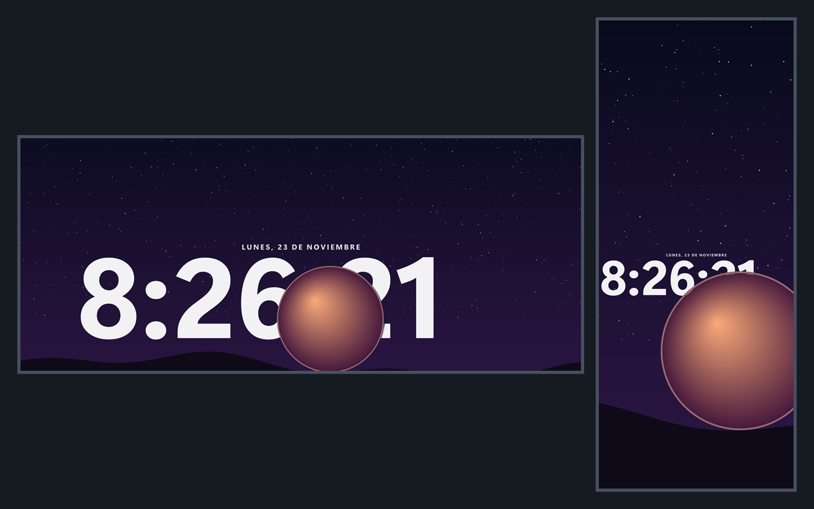

> **1.4.8:** preparativos internos para publicar Streeck Suite en Microsoft Store.

## ✨ Novedades de la 1.4.6 y 1.4.7

> **1.4.7:** las páginas de Ajustes que no caben (como Ojitos) ahora se desplazan con la rueda o la barrita de la derecha.

### Camino a casa
Configura tu trabajo, tu casa, tu hora de salida y los días. Unos minutos antes de salir, la isla te dice **cuánto vas a tardar con el tráfico de ese momento** y qué ruta te conviene, con un mini mapa. Al abrirla ves las rutas que da TomTom, cuánto ahorrarías si sales más tarde y un botón para **navegar en Google Maps**. Usa una clave gratis de TomTom (en Ajustes › Tiempo y agenda › Camino a casa vienen los pasos para sacarla).

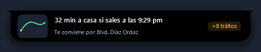

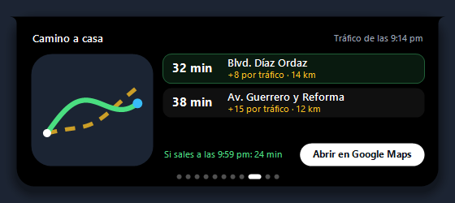

### La isla cobra vida
Rebote suave al abrir, carrusel al cambiar de tarjeta, una respiración cuando te avisa, el brillo con el **color de la canción**, números que ruedan en la hora y el temporizador, **play/pausa que se transforma** y ojitos que miran hacia el aviso. Se apagan en Ajustes › Apariencia.

  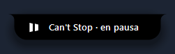
  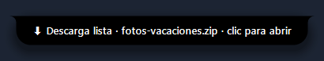

### Avisos nuevos
- **Va a llover en 20 min:** la isla te avisa antes de que llueva en tu zona.
- **Reuniones con «Unirse»:** un minuto antes de una reunión con enlace, un aviso con el botón para entrar.
- **Descargas junto a los ojitos:** el avance de lo que bajas o te llega del celular, y «Descarga lista» con un clic para abrirla. También puedes poner la **velocidad de internet** junto a los ojitos.

  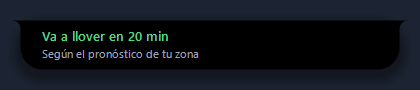
  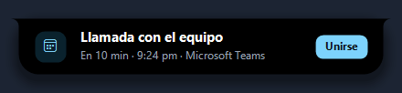

### Y más
- **Gestos en la isla cerrada:** rueda = volumen, clic central = pausa, doble clic = Música.
- **Notas rápidas:** una tarjeta para apuntar al vuelo; se guarda sola y la mandas al celular.
- **Modo enfoque:** «No molestar» durante el Pomodoro y la cuenta de enfoques del día.
- **Claude en la isla** abre donde lo dejaste, carga escondido para abrir al instante y pega lo que copiaste.

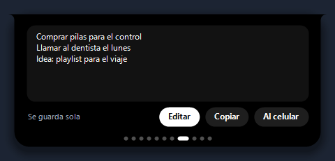

## ✨ Novedades de la 1.4.5

### Papelera en la barra
Una islita junto a tus apps, con el mismo skin que las demás. Un clic la abre; con **clic derecho** ves cuántos elementos hay y cuánto ocupan, y puedes **restaurar todo** o **vaciarla** (Windows siempre pregunta antes). Un puntito avisa cuando tiene algo.

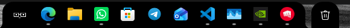

### Y más
- **Copiar texto de la pantalla (Ctrl + Alt + T):** arrastra sobre cualquier texto y queda copiado, en español o inglés. Usa el lector de Windows: no manda tu pantalla a internet. También en la isla › Herramientas.
- **Clic derecho en el menú de inicio:** ejecutar como administrador, abrir la ubicación y desinstalar, en todas las apps.
- **Arranca en segundos** al encender la PC, sin esperar la fila de programas de inicio de Windows.
## ✨ Novedades de la 1.4.2

### 5 ojitos más: ya son 30
**Slime, Rana, Saiyajin, Ninja y Vampiro**, cada uno con sus 8 caras. Y los 25 de antes estrenan **feliz y mareado con personalidad**: el fantasma flota y se derrite, el búho voltea la cabeza, el monóculo se resbala, el pirata enseña su diente de oro… El gato ahora es **pura pupila**.

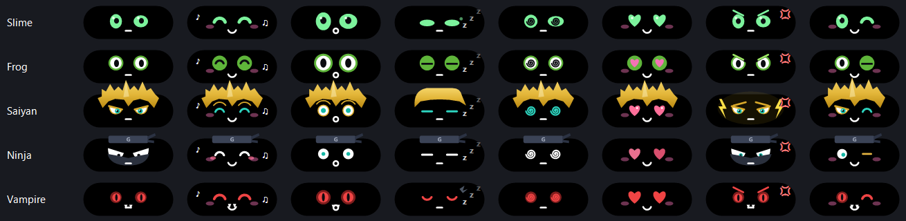

### Y más
- **Hora en 12 o 24 horas:** en automático usa el mismo formato que Windows (reloj 3D, isla, agenda y widgets). También puedes elegirlo en **Ajustes › Tiempo**.
- **Mi ciudad para el clima:** si el clima automático te ubica mal, elige tu ciudad.
- **Se actualiza sola:** las versiones nuevas se instalan cuando no estás usando la PC (y nunca a media partida).
- **PCs con Snapdragon (ARM):** las islas de la barra de tareas ahora también funcionan ahí.
- **Herramientas en Ajustes:** captura, calculadora y bloquear también desde **Ajustes › Herramientas**.
## ✨ Novedades de la 1.4.0

### 16 skins para la isla y la barra
Seis nuevas (**Grafito, Papel, Atardecer, Terminal, Hielo y Oro**) además de las 10 de siempre. En **Ajustes › Apariencia** también eliges la forma (pegada arriba, flotante o la nueva **redondeada**), la letra, el borde (fino o brillo animado) y el fondo sólido o cristal. Con Papel y Hielo la suite pone Windows en modo claro y, al volver a una skin oscura, deja tu configuración como estaba.

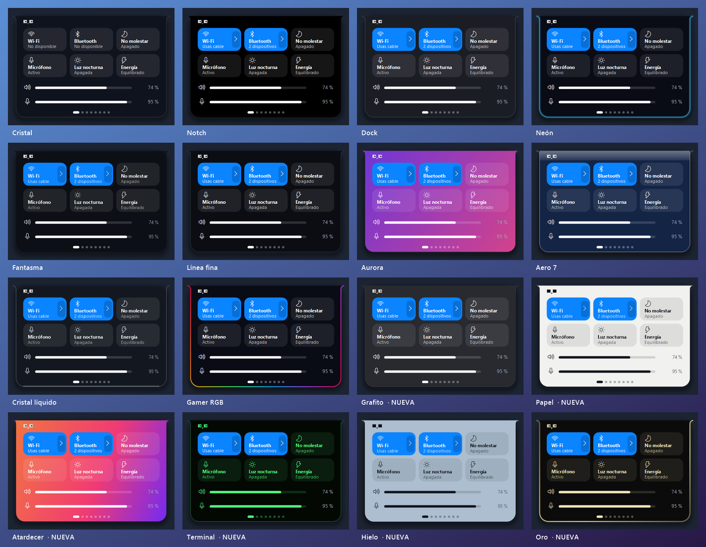

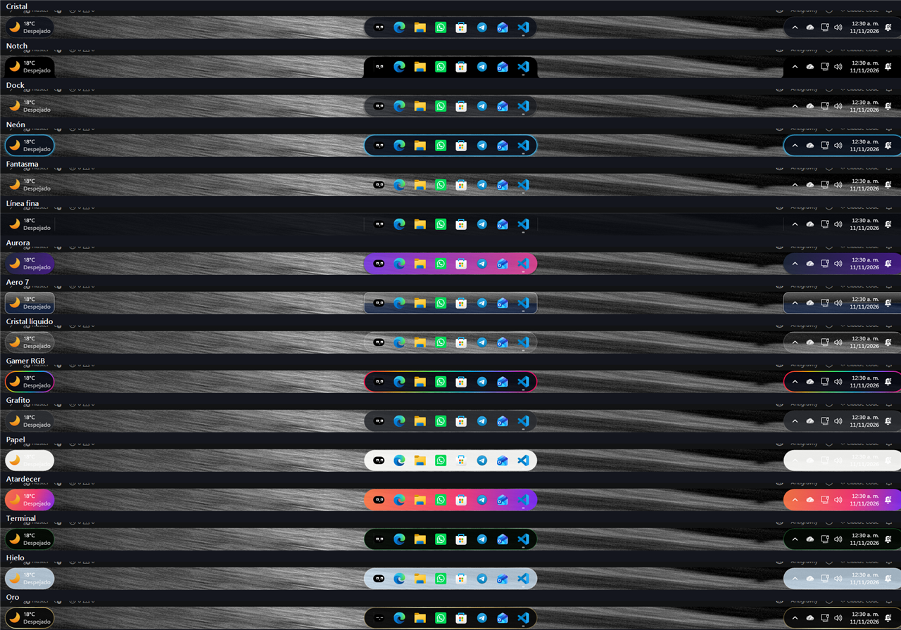

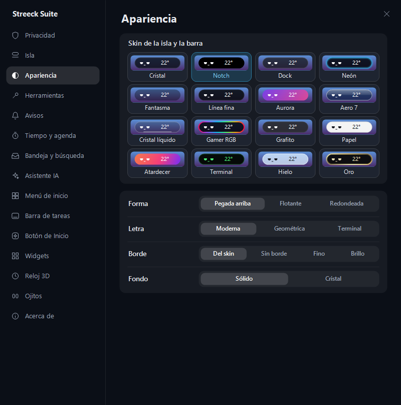

### Herramientas en la isla
Una tarjeta nueva en el carrusel con todo a la mano, por categorías: **Claude** (pregúntale con tu cuenta de claude.ai, sin pagar API), **portapapeles** con historial y buscador, **calculadora**, **enviar y recibir con el celular** por QR y tu Wi-Fi (sin internet ni apps), **silenciar el micrófono**, **captura de pantalla** y **bloquear la PC**. Cada botón trae su atajo escrito.

  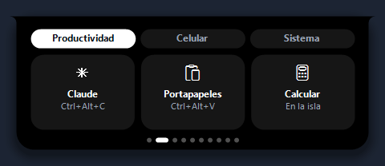
  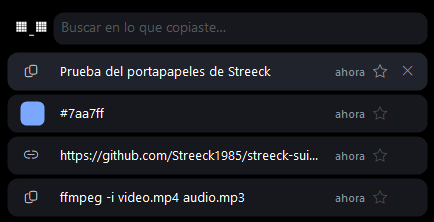

### Y más
- **Controles rápidos nuevos:** micrófono (Ctrl + Alt + M, con aviso rojo en la isla), luz nocturna y modo de energía.
- **Widgets nuevos:** clima, agenda de hoy, música con botones, equipo y cuenta regresiva.
- **25 estilos de ojitos** (10 nuevos) y lo que quieras junto a ellos: clima, hora, fecha, CPU, tu próximo evento o el **cronómetro**.
- **Avisos de agentes de IA:** la isla te dice cuando Claude Code termina o te pide permiso.
- **Reloj 3D:** en «Contorno» los números se paran sobre la silueta, y los fondos de dos monitores se ven completos.
- Al actualizar, una ventana te muestra las **novedades** con botones para probarlas.

  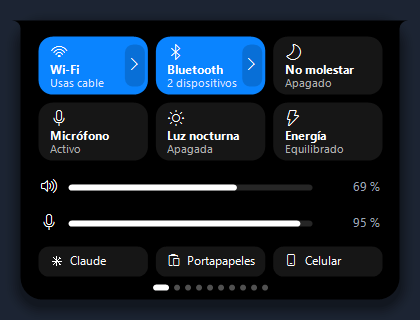
  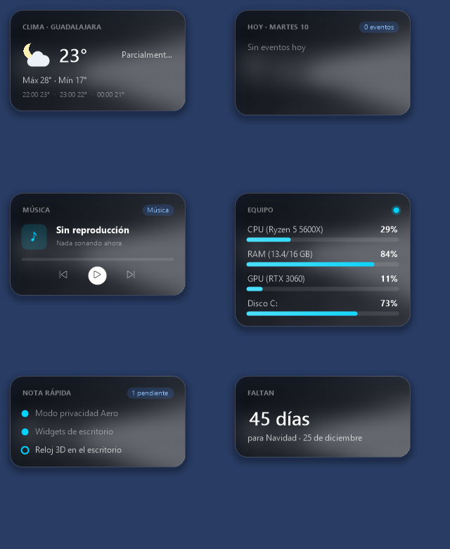

## Isla dinámica

Una isla negra arriba de la pantalla que se abre al pasar el ratón: música con letra, centro de control (Wi-Fi, Bluetooth, volumen y micrófono), calendario con pomodoro, clima, sistema y avisos.

  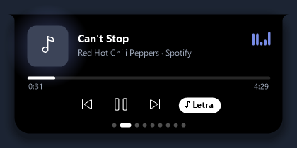
  

  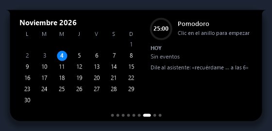

También reemplaza el aviso de volumen de Windows por el suyo:

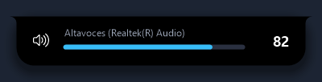

## Ojitos con personalidad

Cuando la isla está cerrada puede mostrar unos ojitos que te siguen con la mirada, parpadean y reaccionan a lo que pasa: se ponen felices con la música, se sorprenden con un aviso, se marean si sacudes el ratón, te guiñan cuando terminas una tarea… y cuando no usas la PC bostezan, cabecean, silban o se estiran hasta quedarse dormidos.

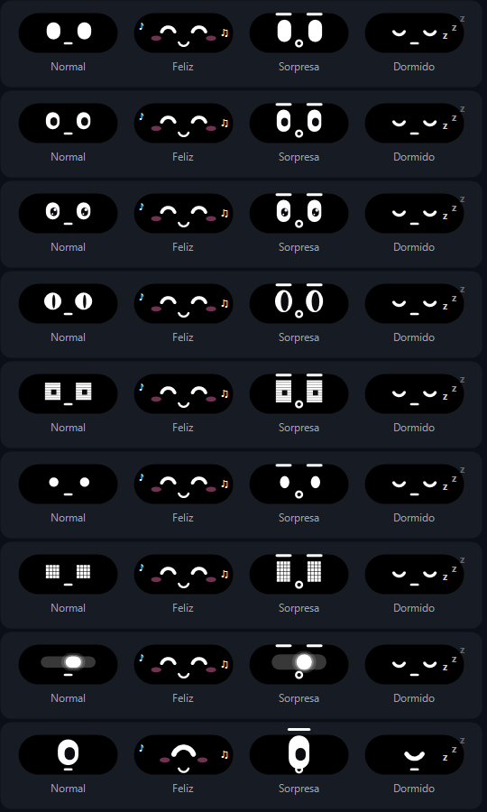

30 estilos (Actual, Con pupila, Anime, Gato, Robot, Puntitos, Pixel, Visor LED, Cíclope, Corazones, Estrellas, Lentes, Búho, Somnoliento, Ciber, Fantasma, Kawaii, Pirata, Espiral, Cachorro, Monóculo, Alien, Panda, Kaomoji, Zombi, Slime, Rana, Saiyajin, Ninja y Vampiro), 5 colores, cejas, boquita y rubor.

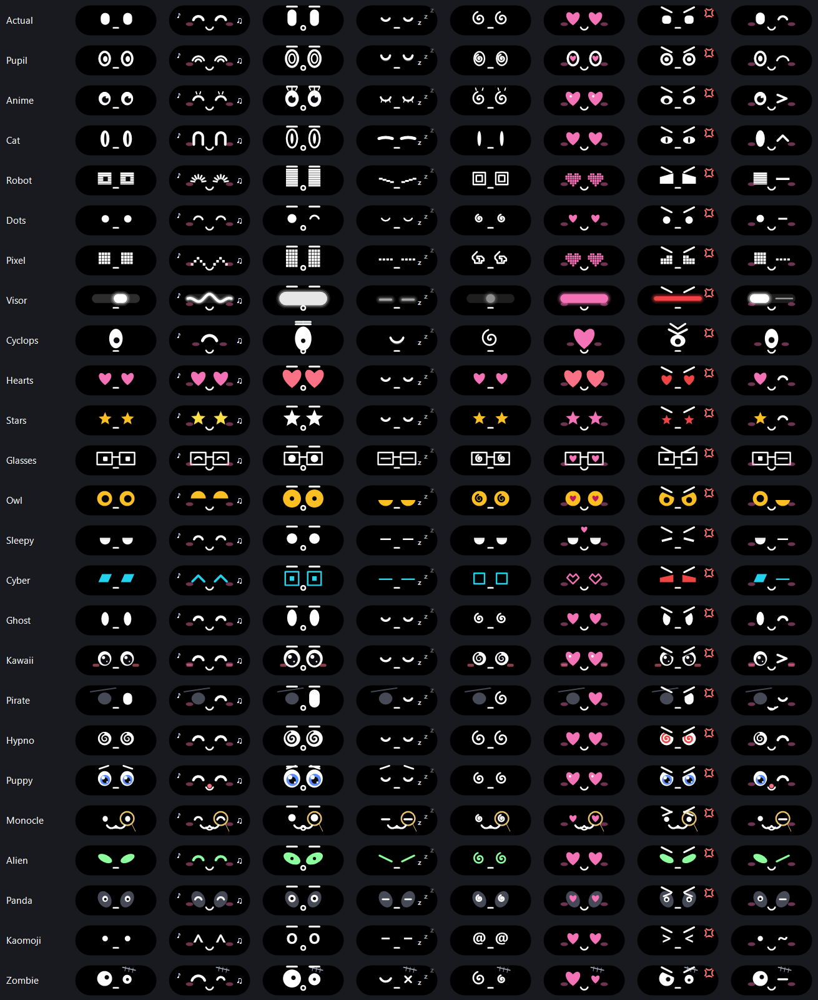

Con música sonando, la carita se pone feliz junto al ecualizador:

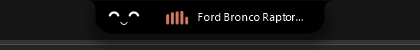

## Barra de tareas con skins

Le pone skin a **la barra real de Windows** (no es una barra falsa): islas a los extremos, 16 skins y un mini reproductor. Funciona en varios monitores.

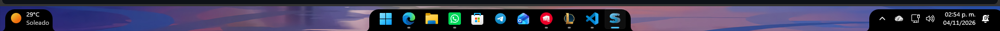

### Icono del botón de Inicio

Cambia el logo de Windows por el logo Streeck, un orbe, unos ojitos que parpadean, una luna, un destello o tu propia imagen. Al darle clic abre el menú de Streeck.

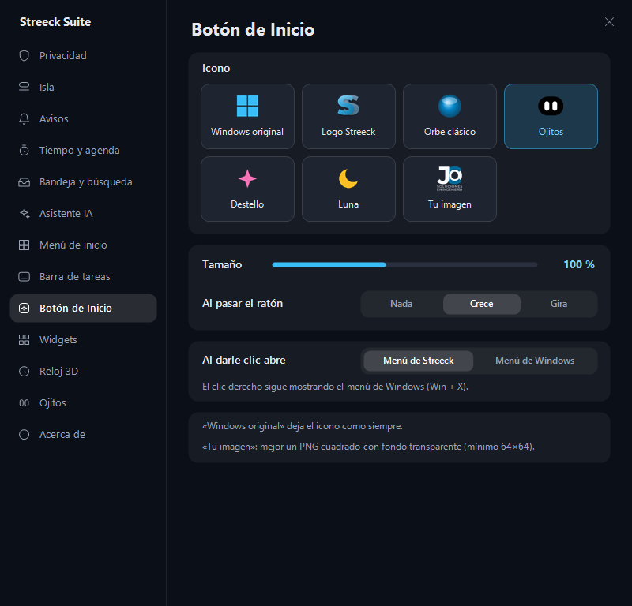

## Panel de ajustes

Todo se configura desde un panel propio en español.

  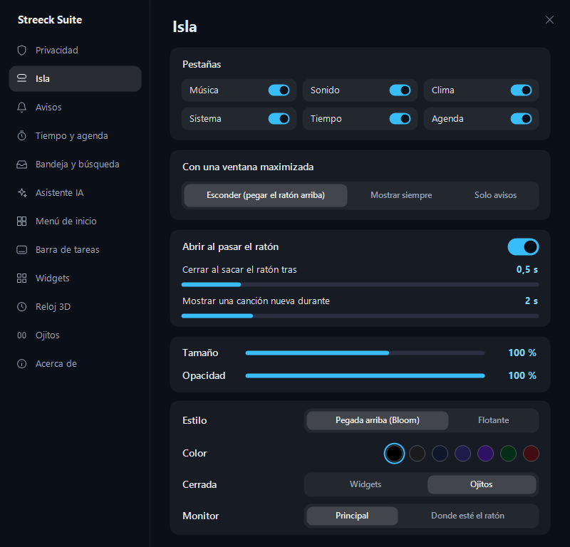
  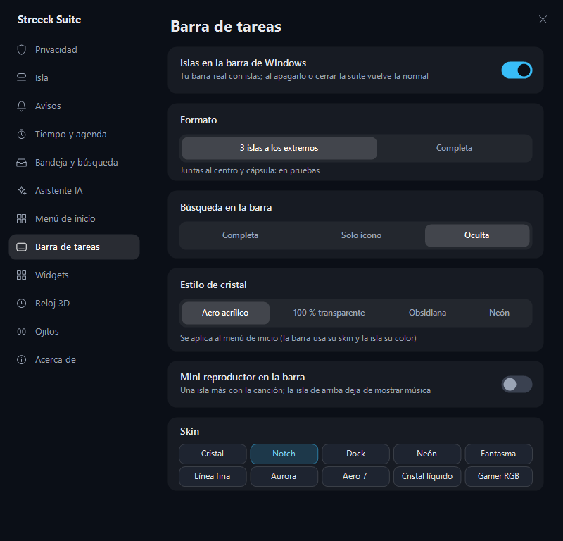

  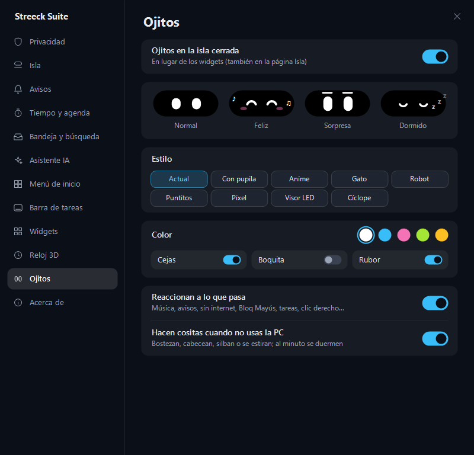
  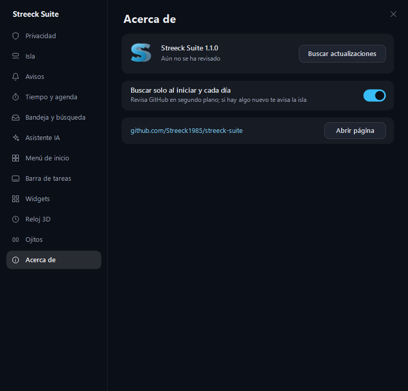

## Y además

- **Reloj 3D** sobre tu fondo de pantalla: detrás del sujeto o con contorno, con la fuente que quieras.
- **Menú de inicio y búsqueda** propios, con asistente de IA (local o Gemini).
- **Icono del botón de Inicio** a tu gusto: logo Streeck, orbe, ojitos que parpadean, luna, destello o tu propia imagen.
- **Modo privacidad** con desenfoque (Ctrl + Alt + P).
- **Bandeja de archivos**, widgets, tareas y recordatorios.
- **Se actualiza sola**: revisa este repositorio y la isla te avisa cuando hay versión nueva.

## Instalar

1. Abre **[Streeck Suite en Microsoft Store](https://apps.microsoft.com/detail/9NS9KQMV2ZN3)**.
2. Pulsa **Obtener**. Se abre sola y arranca con Windows.

**Requisitos:** Windows 11 de 64 bits.

Para desinstalar: **Configuración → Aplicaciones → Streeck Suite → Desinstalar**. La barra de Windows vuelve a quedar como estaba.

[Política de privacidad](https://streeck1985.github.io/streeck-suite/privacidad.html)