

  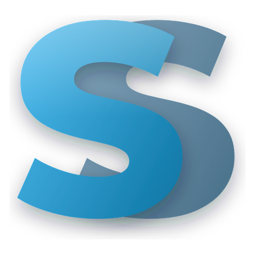

<h1 align="center">Streeck Suite</h1>

  Personaliza Windows 11: isla dinámica arriba, barra de tareas con skins, ojitos con personalidad, reloj 3D sobre tu fondo y más. 
  Ligera (≈ 45 MB de RAM y casi 0 % de CPU en reposo), en español y sin depender de otros programas.

  <a href="https://github.com/Streeck1985/streeck-suite/releases/latest/download/StreeckSuite-Setup.exe"><b>⬇️ Descargar Streeck Suite</b></a>
  &nbsp;·&nbsp;
  <a href="https://github.com/Streeck1985/streeck-suite/releases">Todas las versiones</a>

---

## Isla dinámica

Una isla negra arriba de la pantalla que se abre al pasar el ratón: música con letra, centro de control (Wi-Fi, Bluetooth, volumen y micrófono), calendario con pomodoro, clima, sistema y avisos.

  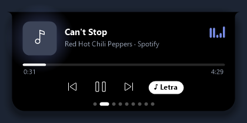
  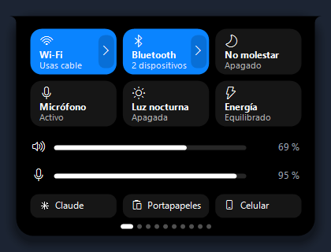

  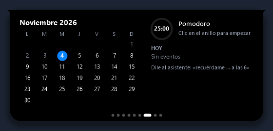

También reemplaza el aviso de volumen de Windows por el suyo:

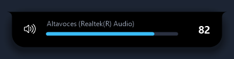

## Ojitos con personalidad

Cuando la isla está cerrada puede mostrar unos ojitos que te siguen con la mirada, parpadean y reaccionan a lo que pasa: se ponen felices con la música, se sorprenden con un aviso, se marean si sacudes el ratón, te guiñan cuando terminas una tarea… y cuando no usas la PC bostezan, cabecean, silban o se estiran hasta quedarse dormidos.

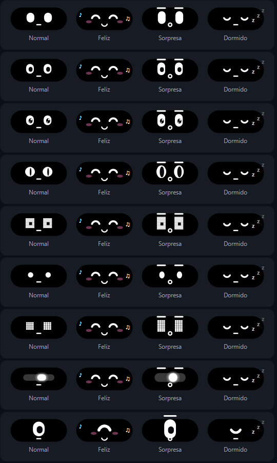

9 estilos (Actual, Con pupila, Anime, Gato, Robot, Puntitos, Pixel, Visor LED y Cíclope), 5 colores, cejas, boquita y rubor.

Con música sonando, la carita se pone feliz junto al ecualizador:

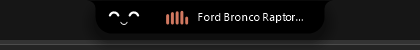

## Barra de tareas con skins

Le pone skin a **la barra real de Windows** (no es una barra falsa): islas a los extremos, 10 skins y un mini reproductor. Funciona en varios monitores.

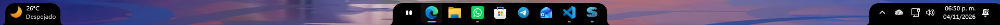

### Icono del botón de Inicio

Cambia el logo de Windows por el logo Streeck, un orbe, unos ojitos que parpadean, una luna, un destello o tu propia imagen. Al darle clic abre el menú de Streeck.

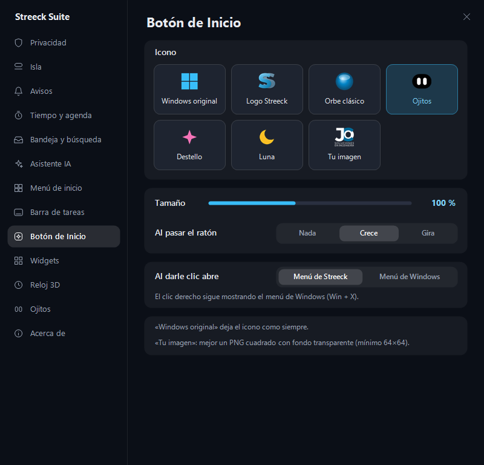

## Panel de ajustes

Todo se configura desde un panel propio en español.

  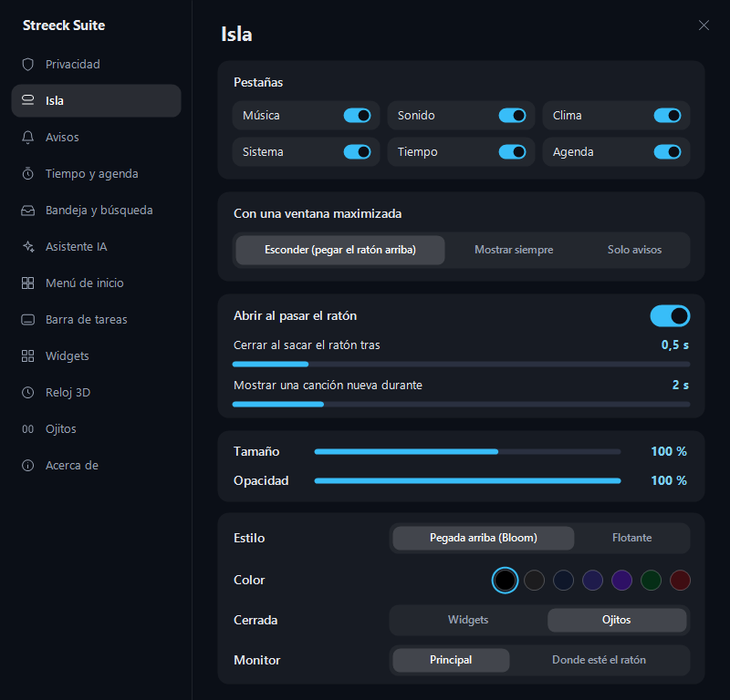
  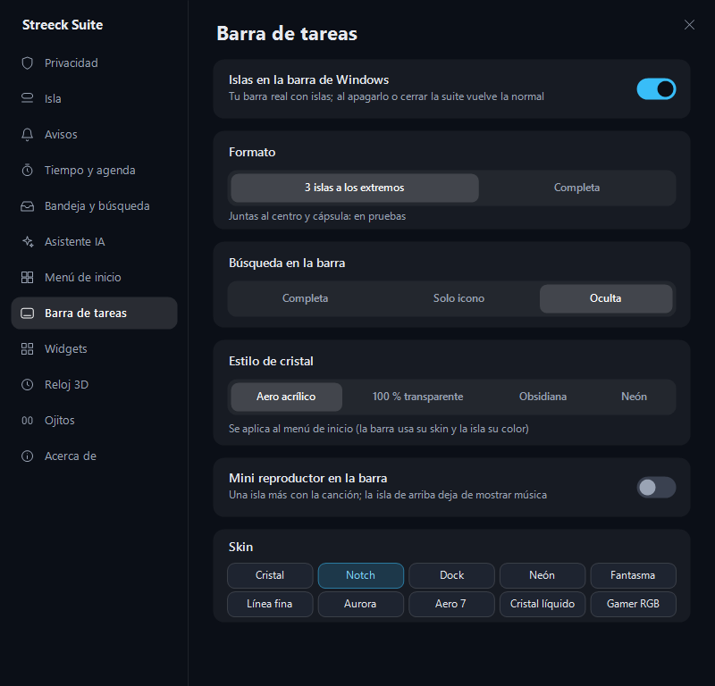

  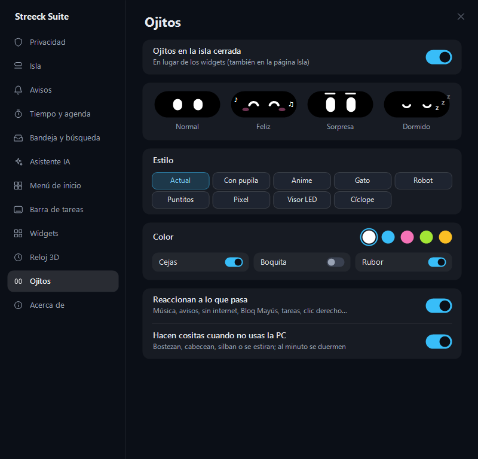
  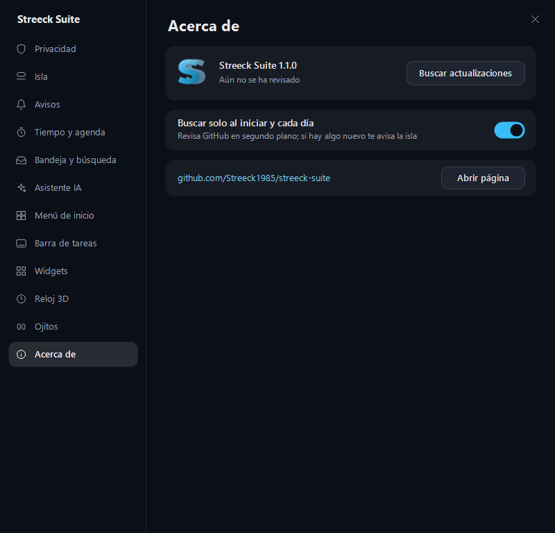

## Y además

- **Reloj 3D** sobre tu fondo de pantalla: detrás del sujeto o con contorno, con la fuente que quieras.
- **Menú de inicio y búsqueda** propios, con asistente de IA (local o Gemini).
- **Icono del botón de Inicio** a tu gusto: logo Streeck, orbe, ojitos que parpadean, luna, destello o tu propia imagen.
- **Modo privacidad** con desenfoque (Ctrl + Alt + P).
- **Bandeja de archivos**, widgets, tareas y recordatorios.
- **Se actualiza sola**: revisa este repositorio y la isla te avisa cuando hay versión nueva.

## Instalar

1. Descarga **[StreeckSuite-Setup.exe](https://github.com/Streeck1985/streeck-suite/releases/latest/download/StreeckSuite-Setup.exe)**.
2. Ábrelo y pulsa **Instalar**. No pide permisos de administrador.
3. Si Windows muestra *«Windows protegió su PC»*, pulsa **Más información → Ejecutar de todas formas** (pasa con los programas nuevos que aún no tienen firma digital).

**Requisitos:** Windows 11 de 64 bits.

Para desinstalar: **Configuración → Aplicaciones → Streeck Suite → Desinstalar**. La barra de Windows vuelve a quedar como estaba.
